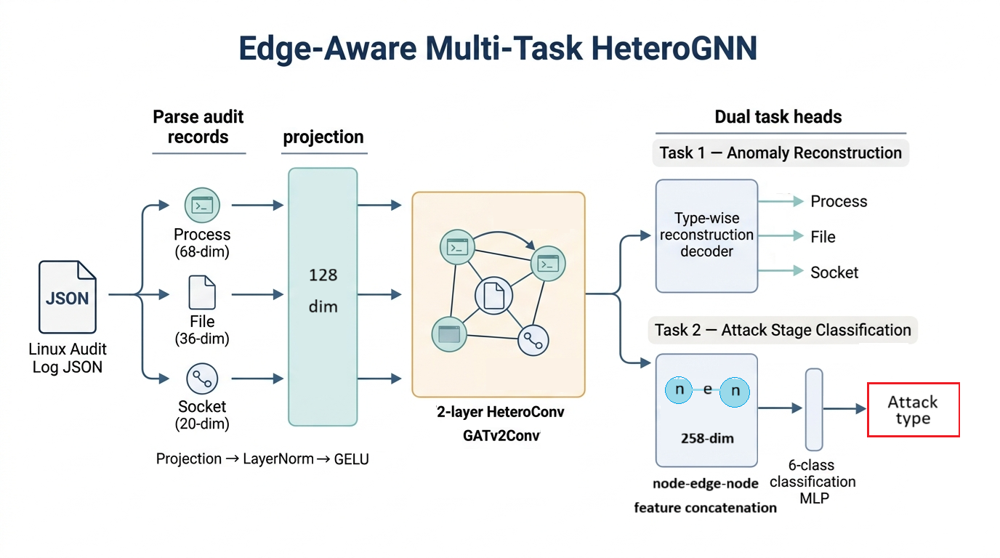

# 모델 상세 정보

---

## 1. 시스템 디렉터리 및 데이터 무결성 정책

| 구분 | 경로 | 역할 및 제약 사항 |
| :--- | :--- | :--- |
| **Raw Metadata & Rules** | `data/fox/dataset.yaml`<br>`data/fox/rules/*.yaml` | AIT-LDS v2.0 `fox` 시나리오(`2022-01-15`~`01-20`) 메타데이터 및 Kyoushi 기반 EQL 공격 규칙 정의. |
| **Host Logs (`gather/`)** | `data/fox/gather/<host>/logs/` | 7개 호스트(`cloud_share`, `inet-firewall`, `internal_share`, `intranet_server`, `mail`, `vpn`, `webserver`) 격리 로그 (`audit/audit.log` 24,082줄 및 `apache2`, `dnsmasq`, `auth`, `openvpn`, `logstash` 데몬 로그). |
| **Ground Truth (`labels/`)** | `data/fox/labels/<host>/logs/` | `gather/`와 대칭 구조. JSONL의 1-based `line` 필드를 통해 원본 로그 라인과 세부 공격 라벨 1:1 매핑. |
| **Read-Only Isolation** | `configs/default.yaml`<br>`processed/fox/`, `artifacts/`, `checkpoints/` | 원본 `data/` 디렉터리 내 쓰기 및 캐시 생성 전면 금지. 전처리 텐서(`.pt`), FastText 모델, 가중치, 추론 샘플 JSON은 외부 경로에만 산출. |

---

## 2. 데이터 파싱 및 그래프 전처리 파이프라인

### 2.1 멀티라인 스트리밍 및 무결성 보장
* **호스트 데몬 로그 선택적 브리지 (`src/parser/streaming_parser.py`, `configs/default.yaml`)**
  * `audit.rules`의 `-D`(커널 syscall 감사 비활성화) 설정으로 인해 `audit.log` 단독으로는 Class 4·5(21줄)만 확보 가능함.
  * Class 1(`scans`), Class 2(`webshell`), Class 3(`cracking`) 확보를 위해 대칭 경로의 `apache2`, `dnsmasq`, `logstash` 로그를 통합하는 설정 제어형 브리지(`include_supplementary_logs`) 적용.
* **누수 방지 메타데이터 추출 (`src/parser/parser.py`)**
  * `extract_audit_meta()`로 밀리초 단위 Unix Epoch 및 `serial_id` 추출 직후 `strip_audit_timestamp()`로 원문의 절대 시각·시리얼 헤더를 소거하여 모델의 시간 암기(Data Leakage) 차단.
* **Stateful Carry-over 청크 병합 (`src/parser/streaming_parser.py`)**
  * 8,000줄 단위 스트리밍 환경에서 `(host_id, serial_id)` 키를 기준으로 `SYSCALL`, `EXECVE`, `CWD`, `PATH`, `SOCKADDR`, `PROCTITLE`, `AVC`, `USER_CMD` 레코드를 단일 이벤트로 병합.
  * `EOE` 미수신 레코드 및 청크 말미 2초 이내 미완성 이벤트는 다음 청크로 이월(Carry-over)하여 경계 절단 방지.
* **인과 보존 안정 정렬 및 프로세스 격리 (`src/parser/streaming_parser.py`)**
  * **Stable Sort:** 동일 밀리초 내 이벤트 순서 보존을 위해 `(timestamp, original_index, event)` 튜플 정렬을 수행하여 전체 엣지의 $\Delta t \ge 0$ 보장.
  * **Identity Isolation:** 모든 토폴로지 키에 `host_id`를 포함하고, 프로세스를 `(host_id, pid, exec_version)`으로 식별(`execve` 또는 바이너리 변경 시 `exec_version` 증가)하여 Cross-Host PID 충돌 및 PID 재사용 오염 제거.

### 2.2 라벨링, 정제 및 그래프 압축
* **2단계 결합 라벨링 (`src/data/phases.py`, `src/data/taxonomy.py`, `configs/taxonomy.yaml`)**
  * 1단계(JSONL 1-based 악성 판정)와 2단계(`ScenarioPhaseMatcher` 기반 공격 구간 매칭: 1월 17일 `service_stop`/`dnsteal` 및 1월 18일 본 공격)를 결합해 6-Class(`0~5`) 부여.
  * 라벨 충돌 시 9종 우선순위 리스트를 적용하며, `RAW_PHASES` 외부 악성 이벤트(`dnsmasq.log` 사전 `dnsteal` 등)는 경고 로깅 후 JSONL 세부 라벨 매핑 우선 적용.
* **경계 기반 Path Sanitizer (`src/graph/sanitizer.py`)**
  * 정규식 `(?<![a-zA-Z])<token>(?![a-zA-Z])`을 적용해 시나리오·호스트명(`fox-access.log` $\rightarrow$ `-access.log`)만 마스킹하고, 정상 바이너리 경로(`/usr/bin/firefox`)의 부분 문자열 훼손 방지.
* **Causality-Preserving Reduction (CPR) (`src/graph/cpr.py`)**
  * 동일 `(src_process, read|write, dst_file)` 쌍에서 $0 \le \Delta t < 1.0\text{s}$ 내 연속 발생, 중간 타 프로세스의 동일 파일 개입 부재, 동일 라벨 조건을 모두 충족하는 버스트 엣지를 병합하고 `cpr_count` 누적(`fox` 기준 16.30%~22.87% 압축률 달성).
* **슬라이딩 윈도우 및 순수 정상 마스크 (`src/graph/builder.py`)**
  * 180초 윈도우·60초 스트라이드로 서브그래프 생성. `ScenarioPhaseMatcher.is_clean_benign_window()` 통과와 윈도우 내 악성 엣지 0건(`edge_y == 0`)을 동시 충족할 때만 `is_clean_benign_window = True`를 부여해 정상 학습 구간의 오염 원천 차단.

---

## 3. 이종 그래프(HeteroGraph) 피처 엔지니어링 스펙

> **Zero-Leakage 원칙:** `host_id`, `pid`, 절대 시각은 모든 입력 텐서에서 배제되며, 노드 차수(`in_deg`, `out_deg`)와 연결 빈도는 현재 윈도우 스냅샷 내부에서만 산출하여 Future Leakage를 차단한다.

| 엔티티 타입 | 차원 | 세부 피처 구성 명세 (`src/graph/encoder.py`, `src/graph/builder.py`) |
| :--- | :---: | :--- |
| **`process` (Node)** | **68-dim** | • **Path HFH (`16-dim`):** 정제된 `exe` 경로의 계층적 해싱(Hierarchical Feature Hashing)<br>• **Cmdline Embedding (`48-dim`):** Train Split `cmdline` 전용 학습 FastText 벡터<br>• **Local Structural (`4-dim`):** `[log1p(in_deg), log1p(out_deg), cmdline_shannon_entropy, uid==0_flag]` |
| **`file` (Node)** | **36-dim** | • **Path HFH (`32-dim`):** `CWD` 결합 및 Sanitizer 처리된 정규 절대경로 HFH<br>• **Local Structural (`4-dim`):** `[log1p(in_deg), log1p(out_deg), path_depth, is_sensitive_path_flag]` |
| **`socket` (Node)** | **20-dim** | • **Subnet HFH (`12-dim`):** IPv4/IPv6 서브넷 프리픽스(A/B/C/D 클래스) 계층 해싱<br>• **Port Encoding (`4-dim`):** 포트 대역 One-hot(Well-known/Registered/Dynamic `3-dim`) + 정규화 포트(`port/65535`, `1-dim`)<br>• **Local Structural (`4-dim`):** `[log1p(in_deg), log1p(out_deg), is_rfc1918_private, log1p(window_conn_freq)]` |
| **`relations` (Edge)** | **2-dim** | • ** 대상 관계(10종):** 정방향 5종(`execute`, `read`, `write`, `fork`, `connect`) + 역방향 5종(`rev_*`)<br>• **Temporal & Compression (`2-dim`):** `[log1p(delta_t), log1p(cpr_count)]` (동일 주체 직전 이벤트 대비 경과 시간 및 CPR 누적 횟수) |

---

## 4. 모델 아키텍처 및 학습·보정 프로토콜



### 4.1 Edge-Aware Multi-Task HeteroGNN (`src/models/hetero_gnn.py`)
1. **Input Projection:** 노드 타입별 선형 투영(`68/36/20 -> 128-dim`) + `LayerNorm` + `GELU`.
2. **Relational Backbone:** 10종 정·역방향 관계별 `GATv2Conv(128, 32, heads=4, edge_dim=2, add_self_loops=False)`를 적용한 2-Layer `HeteroConv` (Residual Connection + `LayerNorm` + `GELU`).
3. **Dual Task Heads:**
   * **Task 1 (Anomaly Reconstruction):** 타입별 경량 복원 디코더(`128 -> 68/36/20`).
   * **Task 2 (Attack Stage Classification):** 양 끝단 노드 임베딩 및 `edge_attr` 결합(`128 + 128 + 2 = 258-dim`) 기반 6-Class 엣지 분류 MLP.

### 4.2 손실 함수 및 학습·추론 스케일링 (`src/models/losses.py`, `src/models/trainer.py`)
* **Multi-Task Objective:**
  $$\mathcal{L}_{\text{total}} = \mathbb{I}(\text{clean\_benign}) \cdot \mathcal{L}_{\text{recon}} + \lambda \cdot \mathcal{L}_{\text{cls}}$$
  * **$\mathcal{L}_{\text{recon}}$ (Task 1):** Scaled Cosine Error($\gamma=3.0$) + MSE. `is_clean_benign_window == True` 구간에서만 타입별 노드 50%를 학습 가능 마스크 토큰으로 치환하여 역전파(악성 구간 복원 손실 `0.0` 강제).
  * **$\mathcal{L}_{\text{cls}}$ (Task 2):** 로그 역빈도 클래스 가중치를 적용한 Multi-Class Focal Loss($\gamma=2.0$). 비마스킹(Unmasked) 원본 임베딩을 사용하여 분류 정확도 보존.
* **데이터 분할 및 추론 캘리브레이션 (`scripts/verify_pipeline.py`):**
  * 윈도우 대표 Tactic 기준 Stratified Split(`70:15:15`) 수행 후 Train Split으로만 FastText 적합.
  * Optimizer: `AdamW` + Gradient Clipping(`max_norm=2.0`).
  * **Anomaly Score Calibration:** 학습 완료 후 순수 정상 윈도우에 대해 결정론적 2-Fold 50% 마스킹 복원 오차의 95분위수(95th Percentile)를 산출하여 `recon_scale` 보정 상수로 확정.

---

## 5. 서빙 인터페이스 및 데이터셋 확장 규격

### 5.1 Three.js / Flask 실시간 추론 API (`src/serving/engine.py`)
* **호출 인터페이스:** `KoTonInferenceEngine(model, taxonomy, recon_scale)` 인스턴스화 후 `predict_window(hetero_data)`(`dict`) 또는 `to_threejs_json(hetero_data)`(`str`) 호출.
* **후처리 규칙:** RFC1918 대역 판별 기반 세션 일관 익명 별칭(`int_host_0`, `ext_host_0`) 부여 및 인접 엣지 최대 위험도 기준 노드별 6-Class Tactic 집계.
* **출력 스키마 (`artifacts/sample_threejs_graph.json`):**
  ```json
  {
    "timestamp": "<float: Unix Epoch ms>",
    "nodes": [
      {
        "id": "<string: <host>_<type>_<identifier>>",
        "type": "<string: process | file | socket>",
        "label": "<string: executable_path | file_path | int_host_N/  ext_host_N (ip:port)>",
        "anomaly_score": "<float: calibrated reconstruction score>",
        "attack_class": "<string: benign | 6-Class Tactic name>",
        "is_malicious": "<boolean>"
      }
    ],
    "edges": [
      {
        "source": "<string: source node id>",
        "target": "<string: target node id>",
        "type": "<string: execute | read | write | fork | connect>",
        "count": "<int: cpr_count>",
        "attack_class": "<string: benign | 6-Class Tactic name>",
        "is_attack_path": "<boolean>"
      }
    ]
  }
  ```

### 5.2 타 데이터셋 확장 가이드

| 대상 데이터셋 | 수정 대상 파일 | 확장 및 적용 절차 |
| --- | --- | --- |
| **AIT-LDS v2.0 타 시나리오**(`russellmitchell`, `harrison`, `santos`, `shaw`, `wardbeck`, `wilson`) | `src/data/phases.py`, `configs/default.yaml` | `wheeler`를 제외한 6개 시나리오의 UTC 공격 단계 구간을 `RAW_PHASES`에 등록하고 `default.yaml`의 대상 시나리오명을 변경하여 코어 코드 수정 없이 파이프라인 실행. |
| **CAM-LDS (2026)**(순정 커널 `auditd` 환경) | `configs/default.yaml`, `configs/taxonomy.yaml`, `src/data/taxonomy.py` | `default.yaml`에서 `include_supplementary_logs: false`로 설정해 멀티라인 `auditd` 파서 단독 구동. `taxonomy.yaml`의 `cam_lds.mitre_tactics` 및 `techniques` 매핑을 편집하여 `LabelTaxonomy.map_cam_lds_label()`로 통합. |